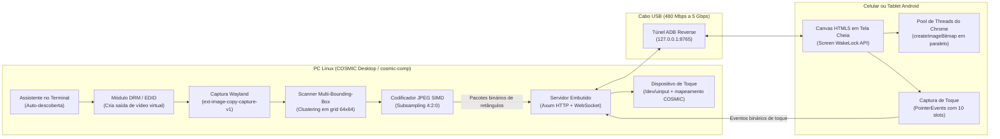

# 📱 DroidMonitor Wayland

Transforme qualquer celular ou tablet Android conectado via cabo USB em um segundo monitor virtual nativo para o **COSMIC Desktop (Wayland)**, com suporte completo a **Multi-Touch** e sem precisar de adaptadores dummy físicos.

---

## ⚡ Destaques

- **Binário único e autocontido:** Escrito 100% em Rust. Não depende de bibliotecas externas em C. O servidor web, gerador de EDID, cliente web e os emuladores de toque estão todos embutidos em um único executável.
- **Nativo para COSMIC Wayland:** Usa o protocolo `ext-image-copy-capture-v1` com captura double-buffered direto do `cosmic-comp`.
- **Zero adaptadores físicos:** Detecta portas de vídeo livres da sua GPU (`/sys/class/drm/`) ou usa o módulo `vkms` para injetar blocos EDID CEA-861 válidos em tempo real.
- **Emulação real de Multi-Touch:** Cria um dispositivo de toque no kernel via `/dev/uinput` (até 10 toques simultâneos) e mapeia as coordenadas diretamente para a saída virtual no COSMIC.
- **Multi-Bounding-Boxes (Delta inteligente):** Grid de 64x64 com refinamento por pixel. O sistema só comprime e transmite as regiões que realmente mudaram na tela, reduzindo drasticamente o uso de banda e entregando **60 FPS com 2 a 3ms de decodificação**.
- **Plug & Play via USB:** Detecta o celular conectado, configura o túnel com `adb reverse`, lê a resolução do aparelho e abre o navegador no Android em tela cheia automaticamente.
- **Limpeza completa ao sair:** Ao apertar `Ctrl+C` ou desconectar o cabo, o monitor virtual é desfeito, as configurações do COSMIC são restauradas e o dispositivo de toque é removido.

---

## 🏗️ Como Funciona a Arquitetura



---

## 🚀 Como Usar

### Pré-requisitos

1. Sistema operacional Linux rodando **COSMIC Desktop** (`cosmic-comp` e `cosmic-randr`).
2. Rust instalado no sistema (versão estável recente).
3. Pacote `adb` instalado (`android-tools` ou `adb` pelo gerenciador de pacotes da sua distribuição).
4. Celular ou tablet Android conectado via USB com a **Depuração USB** ativada nas Opções do Desenvolvedor.

> Caso não use ADB, o programa também permite conexão via rede local ou USB Tethering exibindo um QR Code no terminal.

### Compilação e Execução

Clone o repositório e compile a versão otimizada:

```bash
git clone https://github.com/walefy/droidmonitor_wayland.git
cd droidmonitor_wayland
cargo build --release
```

Para iniciar com o assistente interativo:

```bash
./target/release/droidmonitor
```

Para rodar exibindo estatísticas em tempo real no terminal (FPS do Wayland, quantidade de retângulos por pacote e tempo de decodificação no Android):

```bash
./target/release/droidmonitor --debug
```

Exemplo da saída de telemetria:
```text
📊 [Diagnóstico] Wayland: 130fps (wait 7.5ms) | Dirty: 60pkt/s (1.2 rects/p, avg 48x48, 2.4KB, enc 0.3ms) | Android: 60fps (ACKs 60/s, decode 2ms, fila 0, lag 0)
```

---

## 🎮 Interação e Gestos de Toque

- **Toque simples:** Clique esquerdo.
- **Toque duplo:** Clique duplo (com janela de 450ms e zona morta de 16px para evitar que o clique duplo seja interpretado como arrasto).
- **Pressionar e arrastar:** Seleção de texto, movimentação de janelas ou sliders.
- **Gestos com múltiplos dedos:** Suporte nativo a gestos reconhecidos pelo sistema (como pinça para zoom).
- **Toque com 3 dedos:** Abre o menu HUD na tela do celular para alternar tela cheia, modo de proporção (preencher ou manter proporção) e ver o contador de FPS.

---

## ⚙️ Opções da Linha de Comando

```text
Uso: droidmonitor [OPÇÕES]

Opções:
  -p, --port <PORT>        Porta do servidor HTTP / WebSocket [padrão: 8765]
  -f, --fps <FPS>          Limite de taxa de quadros [padrão: 60]
  -q, --quality <QUALITY>  Qualidade da compressão JPEG (30 a 95) [padrão: 75]
  -d, --debug              Exibe telemetria em tempo real no terminal
  -h, --help               Mostra a ajuda
  -V, --version            Mostra a versão
```

---

## 🔬 Detalhes de Implementação

### 1. Injeção de EDID e Criação do Monitor Virtual
O programa inspeciona `/sys/class/drm` procurando por conectores de vídeo desconectados da GPU física (como `HDMI-A-1` ou `DP-1`). Através do debugfs do kernel (`/sys/kernel/debug/dri/*/force` e `edid`), ele injeta uma estrutura EDID CEA-861 válida gerada em memória com as temporizações exatas da resolução escolhida. O compositor COSMIC reconhece a nova saída como se fosse um monitor físico plugado na placa.

### 2. Captura Double-Buffered no Wayland
Conecta diretamente ao protocolo `ext-image-copy-capture-v1` usando buffers compartilhados em memória (`wl_shm`). Assim que um frame é recebido, o próximo pedido de captura é enfileirado imediatamente no buffer alternado antes mesmo de iniciar o diff ou a compressão. Isso mantém o compositor alimentando frames a mais de 120 FPS sem bloquear a thread de renderização.

### 3. Otimização com Multi-Bounding-Boxes
Em vez de recomprimir telas inteiras ou criar caixas delimitadoras gigantes que cobrem partes não alteradas:
1. A tela é dividida em blocos de 64x64.
2. Blocos alterados são agrupados em até 3 componentes conexos independentes.
3. Cada grupo é refinado nos limites exatos dos pixels alterados.
4. Alterações distantes (como o ponteiro do mouse se movendo no topo e o cursor piscando no terminal embaixo) são enviadas como múltiplos retângulos compactos dentro do mesmo pacote binário:
   ```text
   Cabeçalho: [0x44, 0x4D, num_rects, flags, full_w, full_h]
   ├── [rx, ry, rw, rh, data_len] + [Bytes JPEG do retângulo 1]
   └── [rx, ry, rw, rh, data_len] + [Bytes JPEG do retângulo 2]
   ```
5. No cliente Android, o navegador decodifica todos os retângulos em paralelo no pool de workers nativos do Chrome usando `createImageBitmap`, garantindo decodificação em 2 a 3 milissegundos.

### 4. Mapeamento do Touch no COSMIC
O DroidMonitor cria um dispositivo virtual em `/dev/uinput` com capacidades absolutas de multi-touch. Em seguida, aplica uma configuração atômica no arquivo de dispositivos de entrada do COSMIC (`com.system76.CosmicComp/v1/input_devices`), vinculando o dispositivo de toque diretamente à saída de vídeo virtual.

---

## 🛠️ Solução de Problemas

### Permissão em `/dev/uinput`
O programa solicitará permissão de administrador via `sudo` para configurar a saída DRM e o dispositivo de toque. Se preferir rodar sem pedir senha para o `uinput`, crie uma regra udev:
```bash
echo 'KERNEL=="uinput", MODE="0660", GROUP="input", TAG+="uaccess"' | sudo tee /etc/udev/rules.d/99-uinput.rules
sudo udevadm control --reload-rules && sudo udevadm trigger
```

### Dispositivo "Não autorizado" no ADB
Olhe para a tela do seu celular ou tablet. Um pop-up perguntará se deseja permitir a depuração USB a partir deste computador. Marque a opção "Sempre permitir" e confirme.

### Nenhuma saída DRM livre encontrada
Se todos os conectores físicos da sua placa já estiverem ocupados ou o driver de vídeo não expor conectores desconectados, você pode carregar o driver virtual do kernel:
```bash
sudo modprobe vkms
```

---

## 📄 Licença

Distribuído sob a licença MIT. Consulte o arquivo [LICENSE-MIT](LICENSE-MIT) para mais detalhes.
