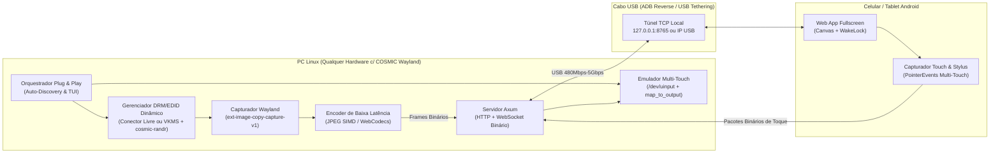

# Especificação Técnica: `droidmonitor_wayland`

> **Objetivo:** Transformar qualquer celular ou tablet Android conectado via cabo USB em um **segundo monitor virtual Plug-and-Play** nativo no **COSMIC Desktop (`cosmic-comp` / Wayland)**, com suporte completo a **Touch Screen Multi-Touch, Stylus (Caneta) e Áudio/Vídeo de baixa latência**, similar ao *Spacedesk* no Windows — **100% autocontido em um único executável Rust**.

---

## 1. Filosofia Plug-and-Play & Portabilidade (Projeto Distribuível)

O projeto é desenhado para ser **distribuível como um único binário autocontido** para qualquer usuário de Linux/COSMIC Wayland. Portanto:
- **PROIBIDO hardcodar caminhos, nomes de monitores, placas de vídeo ou usuários locais:** Nenhuma referência fixa a diretórios de usuário específicos, placas `card1`, saídas `HDMI-A-1` ou `DP-1` deve existir no código. Tudo deve ser descoberto dinamicamente em tempo de execução.
- **Zero Passos Manuais:** O usuário **não deve** precisar rodar scripts paralelos, instalar o Android Studio manualmente, editar arquivos de configuração do sistema na mão, calcular modelines/EDID, configurar `adb reverse` manualmente ou abrir configurações do COSMIC para mapear a tela de toque.

**Fluxo de Experiência do Usuário (UX):**
1. O usuário executa `./droidmonitor` (ou `cargo run --release`).
2. O próprio executável exibe um **Assistente Interativo no Terminal (TUI/CLI)** que:
   - Faz o **Auto-Diagnóstico do Ambiente** (descobre qual GPU e quais conectores DRM estão ativos e livres, onde está o diretório de configuração via `$XDG_CONFIG_HOME` / `$HOME`, e verifica o `cosmic-randr`).
   - Verifica se o `adb` está disponível no sistema; **caso o usuário não tenha o `adb` instalado**, o próprio executável oferece baixar automaticamente o binário oficial portátil do Google (`platform-tools` para Linux) direto em `$XDG_DATA_HOME/droidmonitor/platform-tools/` (ou usar modo USB Tethering/RNDIS sem ADB).
   - Verifica permissões necessárias (`/dev/uinput` e `/sys/kernel/debug/dri`) e, se necessário, solicita a senha de `sudo`/`pkexec` **dentro do próprio fluxo do programa** para aplicar as permissões da sessão.
   - Aguarda ou detecta automaticamente o celular/tablet Android conectado via USB.
   - Se a *Depuração USB (ADB)* ou o *USB Tethering (RNDIS/NCM)* não estiver ativo, exibe instruções claras passo a passo na tela e aguarda a detecção automática em tempo real (hotplug loop).
   - Pergunta (com valores padrão inteligentes ou flags de CLI opcionais):
     - Em relação a qual monitor ativo posicionar (caso o usuário tenha mais de um monitor físico) e a posição (`Direita`, `Esquerda`, `Acima`, `Abaixo`).
     - Orientação (`Paisagem / Landscape` ou `Retrato / Portrait`).
     - Resolução e FPS (`Nativa do aparelho`, `1920x1080 @ 60Hz`, `1280x720 @ 60Hz`, etc.).
3. O executável cria o monitor virtual no conector descoberto (`<VIRTUAL_OUTPUT>`), configura o túnel USB, mapeia o touch screen para esse monitor e **abre automaticamente o navegador no Android em tela cheia** (via `adb shell am start`).
4. Ao pressionar `Ctrl+C` ou desconectar o cabo USB, o executável realiza **rollback completo e limpo** de todo o estado do sistema.

---

## 2. Requisitos de Portabilidade e Descoberta Dinâmica de Hardware

Para garantir que o binário funcione em qualquer PC ou notebook rodando COSMIC (`cosmic-comp`):
- **Descoberta Dinâmica de GPU e Conectores DRM (`/sys/class/drm/card*`):**
  - Enumera todos os dispositivos `/sys/class/drm/card[0-9]-*`.
  - Ignora conectores `Writeback-*` e identifica quais conectores estão `connected` (monitores físicos reais, ex: `eDP-1` em notebooks, `HDMI-A-*`, `DP-*`) e quais estão `disconnected` (elegíveis para monitor virtual).
  - Verifica se há diretório correspondente em `/sys/kernel/debug/dri/<card_index>/<connector_name>/force`.
  - **Fallback Universal (`vkms`):** Se a máquina não tiver nenhum conector físico desconectado (ou se o driver proprietário não suportar `force` via debugfs), carrega automaticamente o módulo de kernel `vkms` (`Virtual-1`).
- **Descoberta Dinâmica da Geometria dos Monitores Ativos (`cosmic-randr` / Wayland):**
  - Lê a saída estruturada de `cosmic-randr list` (ou protocolo `wl_output` / `zcosmic_output_manager_v1`) para descobrir o nome, resolução atual, escala e posição `(x, y)` dos monitores ativos do usuário, calculando automaticamente as coordenadas `(x, y)` exatas para encaixar o monitor virtual sem sobreposição.
- **Protocolo de Captura de Tela Nativo:**
  - `ext_image_copy_capture_manager_v1` (suportado nativamente pelo `cosmic-comp` com `wl_shm` / `linux-dmabuf`).
  - Fallback via `xdg-desktop-portal` / PipeWire caso executado em versões futuras ou outros compositores compatíveis.
- **Subsistema de Input Independente de Máquina:**
  - Criação de dispositivo Multi-Touch via `/dev/uinput` (`evdev`).
  - Resolução do caminho de configuração do COSMIC via variáveis padrão XDG (`$XDG_CONFIG_HOME/cosmic/com.system76.CosmicComp/v1/input_devices` ou `~/.config/cosmic/com.system76.CosmicComp/v1/input_devices`), mapeando dinamicamente `map_to_output: Some("<VIRTUAL_OUTPUT>")`.

---

## 3. Arquitetura do Sistema



---

## 4. Módulos do Executável Rust

### 4.1. `bootstrap.rs` — Auto-Descoberta, Provisionamento de ADB, Permissões e USB
Responsável por garantir que o executável rode em qualquer máquina sem pré-requisitos manuais:
1. **Descoberta ou Provisionamento Automático do `adb`:**
   - Procura o executável `adb` na seguinte ordem:
     1. Variável de ambiente `$ADB_PATH` ou no `$PATH` do sistema (`which adb`).
     2. Diretório de dados próprio do app (`$XDG_DATA_HOME/droidmonitor/platform-tools/adb`).
     3. Caminhos padrão de SDK Android (`$ANDROID_HOME/platform-tools/adb`, `$HOME/Android/Sdk/platform-tools/adb`, `/opt/android-sdk/platform-tools/adb`).
   - **Auto-Download Portátil (Fallback Zero-Install):** Se o `adb` não for encontrado em nenhum lugar da máquina do usuário, o executável pergunta se pode baixar automaticamente o pacote oficial `platform-tools-latest-linux.zip` do Google (~15 MB) para `$XDG_DATA_HOME/droidmonitor/platform-tools/` (sem tocar no sistema global) ou seguir via modo *USB Tethering (RNDIS/NCM)*.
2. **Detecção do Dispositivo Android:**
   - Monitora `adb devices -l` e também interfaces de rede USB locais (`usb*`, `rndis*`, `enp*u*`) via netlink/`ip`.
   - Caso o aparelho esteja como `unauthorized`, orienta o usuário no terminal: *"Toque em 'Permitir Depuração USB' na tela do seu celular/tablet..."* e aguarda até o status mudar para `device`.
   - Lê automaticamente o modelo (`ro.product.model`), resolução física (`adb shell wm size`) e densidade (`adb shell wm density`) do Android para sugerir a resolução ideal do monitor virtual.
3. **Elevação de Privilégios Sob Demanda (Root Helper Interno):**
   - Para injetar o EDID/forçar o conector DRM em `/sys/kernel/debug/dri/...` e liberar `/dev/uinput`, o próprio binário invoca `sudo` (ou `pkexec`) passando um subcomando interno (`droidmonitor --internal-privileged-helper ...`), evitando que todo o servidor Wayland/WebSocket rode como `root` (pois sockets Wayland e PipeWire pertencem ao usuário da sessão).

---

### 4.2. `edid.rs` & `display.rs` — Criação Agnóstica do Monitor Virtual
1. **Gerador de EDID Dinâmico em Memória (`edid.rs`):**
   - Gera em tempo de execução um bloco **EDID 1.4 válido de 128 bytes** com *Detailed Timing Descriptor (DTD)* calculado para qualquer resolução e taxa de atualização escolhidas (ex: `1920x1080@60`, `2000x1200@60`, `1600x900@60`, ou modo retrato).
   - Calcula automaticamente os blankings CVT Reduced Blanking e o byte de checksum do EDID.
2. **Seleção e Ativação Dinâmica de Conector (`display.rs`):**
   - **Estratégia Primária (Conector Livre Descoberto na GPU Ativa):**
     - Escaneia `/sys/class/drm/` procurando a GPU primária em uso pelo compositor e seleciona o primeiro conector `DP-*` ou `HDMI-A-*` com status `disconnected` que possua suporte a `force` e `edid_override` no `debugfs`.
     - Injeta os 128 bytes do EDID e força o conector para `on`.
     - Dispara `udevadm trigger --subsystem-match=drm` para o `cosmic-comp` detectar o hotplug imediatamente.
   - **Estratégia de Fallback Universal (`vkms`):**
     - Se não houver conector livre compatível (ex: notebook sem portas extras disponíveis no mux), carrega `modprobe vkms` para criar um conector virtual e aplica o modo desejado.
3. **Posicionamento Dinâmico via `cosmic-randr`:**
   - Faz parse da topologia atual do `cosmic-randr list` para identificar a posição `(base_x, base_y)` e dimensões `(base_w, base_h)` do monitor de referência escolhido pelo usuário.
   - Executa `cosmic-randr enable <VIRTUAL_OUTPUT>`, `cosmic-randr mode <VIRTUAL_OUTPUT> <W> <H>` e `cosmic-randr position <VIRTUAL_OUTPUT> <TARGET_X> <TARGET_Y>`.
4. **Destruição Segura (Drop / Signal Handler):**
   - Registra handlers para `SIGINT`, `SIGTERM`, `SIGHUP` e `panic!` hook.
   - Ao encerrar, executa `cosmic-randr disable <VIRTUAL_OUTPUT>` e restaura `unspecified` no `force` do conector DRM utilizado, removendo o monitor virtual sem deixar telas fantasmas.

---

### 4.3. `capture.rs` & `encoder.rs` — Captura Wayland e Codificação Rápida
1. **Captura Nativa por `wl_output`:**
   - Conecta ao socket Wayland da sessão (`$WAYLAND_DISPLAY`) usando `wayland-client`.
   - Associa os objetos globais `wl_output` + `zxdg_output_v1` pelo nome dinâmico do conector (`<VIRTUAL_OUTPUT>`).
   - Usa o protocolo **`ext_image_copy_capture_manager_v1`** com `paint_cursors` ativado para capturar os frames compostos apenas daquele monitor virtual.
2. **Codificação de Baixa Latência:**
   - **Modo Ultra-Low Latency (Padrão para Cabo USB):**
     - Codifica os frames em **JPEG de alta velocidade (com SIMD)** enviando via WebSocket binário apenas quando há mudança ou até a taxa de atualização configurada (30/60 FPS), com controle de backpressure (nunca enfileira frames atrasados se a conexão oscilar).
     - Suporte a ajuste dinâmico de qualidade (`Quality 40..95`) e escala (`50%..100%`) em tempo real direto na interface do celular.

---

### 4.4. `input.rs` & `cosmic_config.rs` — Touch Screen Multi-Touch Mapeado
Para que o toque no celular/tablet funcione **exatamente dentro do segundo monitor** em qualquer máquina com COSMIC:
1. **Dispositivo Multi-Touch Linux (`/dev/uinput`):**
   - Cria um dispositivo `DroidMonitor Virtual Touchscreen` via crate `evdev`.
   - Habilita `INPUT_PROP_DIRECT` (tela de toque direta) e protocolo **Linux Multi-Touch Tipo B** (`ABS_MT_SLOT` para até 10 dedos simultâneos, `ABS_MT_TRACKING_ID`, `ABS_MT_POSITION_X`, `ABS_MT_POSITION_Y`, `ABS_X`, `ABS_Y`, `BTN_TOUCH`) com eixo `0..32767`.
2. **Vinculação Dinâmica ao `<VIRTUAL_OUTPUT>` no COSMIC (`cosmic_config.rs`):**
   - Localiza `$XDG_CONFIG_HOME/cosmic/com.system76.CosmicComp/v1/input_devices` (ou `~/.config/cosmic/...`).
   - Faz parse seguro ou preserva as entradas existentes de outros dispositivos do usuário no arquivo RON e adiciona/atualiza apenas a chave `"DroidMonitor Virtual Touchscreen"` com `map_to_output: Some("<VIRTUAL_OUTPUT>")`.
   - Ao encerrar o `droidmonitor`, restaura o arquivo exatamente ao estado original do usuário.

---

### 4.5. `server.rs` & `client.html` — Transmissão USB e Cliente Android
1. **Conexão Automática via USB (ADB Reverse + Fallback USB Tethering):**
   - **Via ADB:** Executa `adb -s <SERIAL> reverse tcp:<PORT> tcp:<PORT>` e abre automaticamente o navegador do Android via `adb -s <SERIAL> shell am start -a android.intent.action.VIEW -d "http://127.0.0.1:<PORT>"`.
   - **Via USB Tethering / Rede Local:** Também escuta em `0.0.0.0:<PORT>` e exibe no terminal todas as URLs locais detectadas (e um QR Code no próprio terminal em caracteres UTF-8!) para que qualquer dispositivo possa conectar mesmo sem ADB.
2. **Cliente Web Embarcado (Single-Binary Asset):**
   - Todo o HTML/CSS/JS do cliente Android fica embutido dentro do executável Rust (`include_str!`), garantindo que o binário possa ser copiado para `/usr/local/bin/droidmonitor` ou distribuído isoladamente sem pastas externas.
   - **Recursos do Cliente Web no Android:**
     - **Fullscreen API + Screen Orientation Lock:** Botão inicial de 1 toque para entrar em tela cheia total, ocultar barras do Android e travar a orientação.
     - **Screen Wake Lock API (`navigator.wakeLock`):** Impede que a tela do celular/tablet apague sozinha enquanto estiver funcionando como monitor.
     - **Renderizador Canvas de Baixa Latência:** Decodifica os frames binários recebidos via WebSocket (`Blob` / `createImageBitmap`) sincronizado com `requestAnimationFrame`.
     - **Captura Multi-Touch Completa (`TouchEvents` / `PointerEvents`):**
       - Captura `touchstart`, `touchmove`, `touchend`, `touchcancel` com `passive: false`.
       - Envia pacotes binários compactos por dedo via WebSocket para latência mínima de toque (< 2ms via USB).
     - **HUD Flutuante Ocultável:** Menu discreto para alternar Tela Cheia, Qualidade de Imagem, Escala e Estatísticas de FPS/Latência.

---

## 5. Estrutura de Diretórios do Projeto

```text
droidmonitor_wayland/
├── Cargo.toml
├── SPEC.md
└── src/
    ├── main.rs               # Entrypoint, CLI/TUI interativo, ciclo de vida e signal cleanup
    ├── bootstrap.rs          # Auto-descoberta de hardware, download/detecção de ADB, sudo helper
    ├── edid.rs               # Gerador de binário EDID 1.4 dinâmico para qualquer resolução/Hz
    ├── display.rs            # Descoberta de conector DRM livre/vkms e orquestração do cosmic-randr
    ├── cosmic_config.rs      # Vinculação dinâmica do Touchscreen ao <VIRTUAL_OUTPUT> no COSMIC
    ├── capture.rs            # Captura de frames Wayland (ext-image-copy-capture-v1)
    ├── input.rs              # Emulador Multi-Touch Tipo B via /dev/uinput (evdev)
    ├── server.rs             # Servidor Axum + WebSocket de baixa latência (vídeo + touch)
    └── client.html           # Aplicação Web Fullscreen embutida no binário (include_str!)
```

---

## 6. Dependências Principais (Crates Rust)

| Crate | Finalidade |
| :--- | :--- |
| `tokio` | Runtime assíncrono para servidor WebSocket, captura e loops de I/O |
| `axum` | Servidor HTTP + WebSocket binário autocontido |
| `evdev` | Criação e emissão de eventos Multi-Touch no `/dev/uinput` |
| `wayland-client` / `wayland-protocols` | Comunicação nativa com `cosmic-comp` (`wl_output`, `wl_shm`, `ext-image-copy-capture-v1`) |
| `image` / `jpeg-encoder` | Compressão rápida de frames em memória |
| `clap` / `dialoguer` / `console` | Interface interativa de terminal (prompts Plug-and-Play) |
| `ctrlc` / `nix` | Tratamento de sinais POSIX e restauração garantida do monitor no encerramento |
| `dirs` | Descoberta portável de diretórios XDG (`$XDG_CONFIG_HOME`, `$XDG_DATA_HOME`) |
| `anyhow` / `tracing` | Diagnóstico claro de erros e logs estruturados |

---

## 7. Plano de Implementação (Fases)

### Fase 1: Auto-Descoberta de Hardware, Core de Display Virtual & Cleanup Seguro
- Implementar `edid.rs` (gerador de EDID customizado com cálculo dinâmico de timing e checksum).
- Implementar `display.rs` para escanear `/sys/class/drm/card*` e `cosmic-randr list` dinamicamente, ativar o conector livre (ou `vkms`), posicioná-lo em relação ao monitor ativo escolhido e garantir rollback completo no `Ctrl+C`.
- Implementar `bootstrap.rs` com elevação de privilégios sob demanda (`sudo` helper interno).

### Fase 2: Emulação Multi-Touch Portável Mapeada ao 2º Monitor
- Implementar `input.rs` criando o dispositivo `DroidMonitor Virtual Touchscreen` via `/dev/uinput`.
- Implementar `cosmic_config.rs` usando `dirs::config_dir()` para mapear `map_to_output: Some("<VIRTUAL_OUTPUT>")` no `cosmic-comp` preservando configurações existentes do usuário e restaurando ao sair.

### Fase 3: Captura de Tela Wayland + Streaming USB Single-Binary
- Implementar `capture.rs` capturando exclusivamente a saída `<VIRTUAL_OUTPUT>` no Wayland (`ext-image-copy-capture-v1`).
- Implementar `server.rs` e `client.html` (embutido via `include_str!`) com streaming binário via WebSocket, `WakeLock`, Fullscreen e captura Multi-Touch.

### Fase 4: Automação USB Universal (ADB Auto-Provisioning + USB Tethering + QR Code)
- Integrar descoberta de `adb` (com opção de auto-download do `platform-tools` oficial em `$XDG_DATA_HOME/droidmonitor/` caso a máquina não tenha `adb`), leitura automática da resolução nativa do Android, `adb reverse`, auto-abertura do navegador e exibição de QR Code no terminal como alternativa para conexão via USB Tethering/Wi-Fi.

